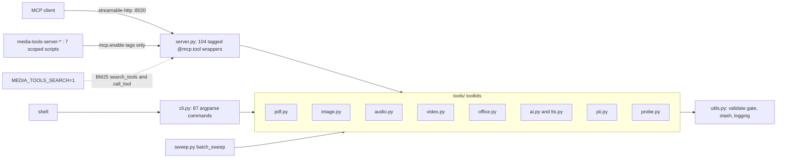
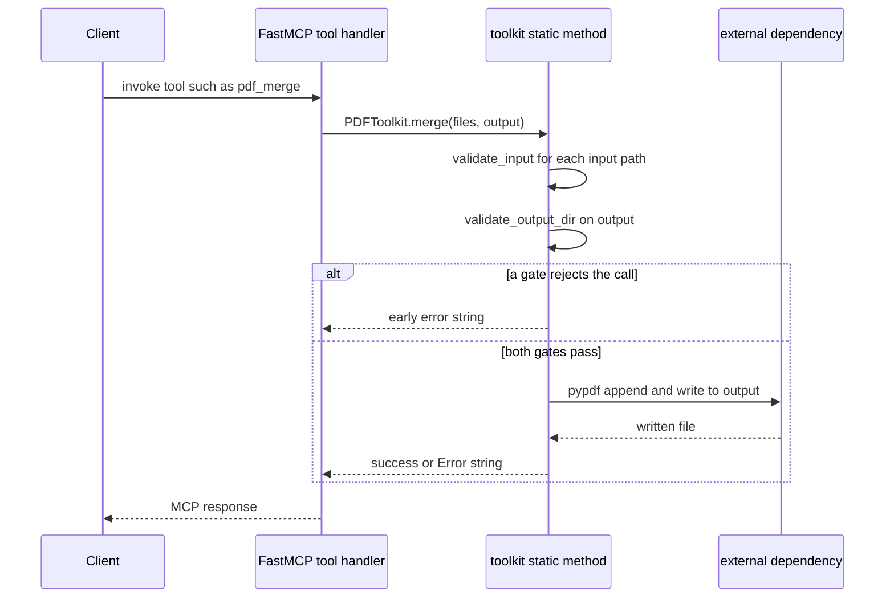
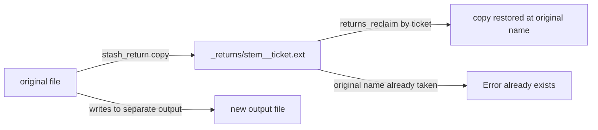

## High-Level Design

media-tools is a **three-front-door** package: one set of toolkits is reachable from the full MCP
server, from category-scoped MCP servers, or from the CLI. The front doors are thin shells — they
never call each other over MCP, they call toolkit static methods directly — so a request behaves
identically no matter which door it enters.

- **104 MCP tools** are registered in `server.py`, each tagged with one family: `pdf` 31,
  `video` 24, `image` 24, `audio` 13, `office` 5, `ai` 3, `pii` 2, `batch` 1, `tts` 1.
- **87 CLI commands** live in `cli.py` across nine categories: `pdf` 24, `image` 22, `video` 22,
  `audio` 12, `office` 2, `pii` 2, `batch` 1, `returns` 1, `probe` 1.
- **Nine toolkit classes** — `PDFToolkit`, `VideoToolkit`, `ImageToolkit`, `OfficeToolkit`,
  `AudioToolkit`, `AIToolkit`, `PiiToolkit`, `ProbeToolkit`, `TTSToolkit` — are plain collections of
  `@staticmethod`s with no shared mutable state. Batch work is not a toolkit class: it lives in the
  `sweep.py` module (`sweep()` plus a five-op dispatch table).

The end-to-end flow is:

```
Client → front door (FastMCP tool handler, scoped server, or CLI handler)
        → toolkit static method (or sweep / probe / returns utility)
        → utils.validate_input / validate_output_dir gate
        → external dependency (local binary, library, or LiteLLM)
        → result or "Error: ..." string back up the stack
```



*The three front doors, the shared toolkit layer, and the utilities they all run through.*

## Request Flow

The following sequence shows a representative request (`pdf_merge`) from client to external
dependency and back. Every other tool follows the same shape: a thin handler delegates to a toolkit
method, the method gates on input/output validation, then performs work through an external
dependency and returns a string.



*One tool call end to end: thin handler, validation gate, external work, string result.*

## Entry Points

### Full MCP server (`server.py`)

`server.py` builds one `FastMCP("Media Tools")` instance and registers every tool as a
`@mcp.tool(name=..., tags={...})` decorator. Each decorator is a **thin wrapper** carrying a family
tag and delegating to the matching toolkit static method. Importing the module also calls
`setup_logging(os.environ.get("LOG_LEVEL", "INFO"))`, so the package logger is configured before
any request is handled. AI, TTS, and probe wrappers import their toolkit *inside* the handler, which
keeps module load light and keeps the heavy toolkits off the import path of the other tools.

```python
mcp = FastMCP("Media Tools", instructions="...")

@mcp.tool(name="pdf_merge", tags={"pdf"})
def pdf_merge(files: list[str], output: str, cover: bool = False) -> str:
    """Merge multiple PDF files into a single output file. cover=True also renders a page-1 thumbnail."""
    return PDFToolkit.merge(files, output, cover)
```

`main()` starts the server over the `streamable-http` transport (a browser-capable transport, so
clients such as OpenWebUI can connect) on `HOST`/`PORT`, defaulting to `127.0.0.1:8020`:

```python
def main():
    if os.environ.get("MEDIA_TOOLS_SEARCH") == "1":
        from fastmcp.server.transforms.search import BM25SearchTransform
        mcp.add_transform(BM25SearchTransform(max_results=5))
    port = int(os.environ.get("PORT", "8020"))
    host = os.environ.get("HOST", "127.0.0.1")
    mcp.run(transport="streamable-http", host=host, port=port)
```

With `MEDIA_TOOLS_SEARCH=1` the transform replaces the full `tools/list` with `search_tools` plus
`call_tool`, which keeps the discovery payload small; it changes what a client can *list*, never
what a tool *does*, and only `main()` installs it (the scoped entry points do not).

### Category-scoped servers (`main_*`)

`[project.scripts]` in `pyproject.toml` defines nine console scripts in this order: the CLI
(`media-tools` → `cli.main`), the full server (`media-tools-server` → `server.main`), then seven
category-scoped servers (`media-tools-server-pdf`, `-image`, `-audio`, `-video`, `-office`, `-ai`,
`-tts`). Each scoped script maps to a `main_*` function that calls the shared helper:

```python
def _run_scoped(tag: str):
    mcp.enable(tags={tag}, only=True)
    port = int(os.environ.get("PORT", "8020"))
    host = os.environ.get("HOST", "127.0.0.1")
    mcp.run(transport="streamable-http", host=host, port=port)
```

`mcp.enable(tags={tag}, only=True)` hides every tool outside that family, so an operator gets a lean
server without maintaining separate server code. An eighth function, `main_batch` (tag `batch`),
exists at the bottom of `server.py` but has **no console script** in `pyproject.toml`, so the
`batch_sweep` tool is reachable only through the full server or the CLI.

Which surface exposes which family:

| Surface | Families |
|---------|----------|
| Full server (`media-tools-server`) | all 104 tools, including `pii` and `batch` |
| Scoped servers (`media-tools-server-*`) | `pdf`, `image`, `audio`, `video`, `office`, `ai`, `tts` |
| CLI (`media-tools`) | `pdf`, `image`, `audio`, `video`, `office`, `pii`, `batch`, `returns`, `probe` — no AI/TTS commands |

Cross-cutting utilities tagged `pdf` (`media_probe`, `returns_reclaim`) therefore ride along in a
`pdf`-scoped server, while `batch_sweep` does not appear in any scoped server.

### CLI (`cli.py`)

The CLI is a hand-rolled `argparse` tree with two levels: `category` → `command`. Commands are
registered through an internal `add()` helper that adds the flags and stores the handler via
`sub.set_defaults(handler=handler)`; the `probe` category sets its handler directly instead. `main()`
parses arguments, dispatches to `ns.handler(ns)`, and wraps the outcome in JSON through `_result()` /
`_error()` so agents can parse results uniformly:

```python
def main(argv: list[str] | None = None) -> int:
    parser = build_parser()
    ns = parser.parse_args(argv)
    try:
        result = ns.handler(ns)
    except Exception as exc:
        print(_error(str(exc)))
        return 1
    print(_result(result))
    return 0
```

**Key design decisions:**

- **No CLI framework**: hand-rolled `argparse` keeps the package dependency-light.
- **JSON output**: every command prints JSON (`{"result": ...}` or `{"error": ...}`) and exits 1 on a
  raised exception.
- **Shared work**: handlers pull arguments from the parsed namespace and call the exact same
  `ToolkitClass.method()` the MCP wrappers call (e.g. `_pdf_merge` → `PDFToolkit.merge`), so the two
  interfaces cannot drift. The CLI imports toolkits from their submodules rather than through the
  package `__init__`.

## Shared Validation & Logging Pipeline (`utils.py`)

`utils.py` is the single shared pipeline every toolkit method runs through before doing work.

- **`validate_input(path, label)`** — returns an error string (or `None`) after checking that the
  path is non-empty, contains no `..` components (path-traversal block), exists, is a regular file,
  and is readable. `http://` / `https://` URLs are let through untouched so URL-accepting tools can
  work on remote documents.
- **`validate_output_dir(path, label)`** — returns an error string (or `None`) after creating the
  output directory if it is missing (`mkdir(parents=True, exist_ok=True)`, catching `OSError`) and
  confirming the parent is writable.

A representative method gates on both at its top and returns the first error string it hits:

```python
def merge(files: list[str], output: str, cover: bool = False) -> str:
    for f in files:
        err = validate_input(f)
        if err:
            return err
    err = validate_output_dir(output)
    if err:
        return err
    # ... work via pypdf ...
```

`TTSToolkit.convert` is the notable exception: its input is free text rather than a file, so it
calls only `validate_output_dir` plus an empty-text check and never calls `validate_input`.

Three further helpers complete the pipeline:

- **`setup_logging(level)`** — configures the `media_tools` logger with timestamped output.
- **`_subprocess_with_logging(cmd, description)`** — runs a subprocess with captured output and
  logging, returning `(result_string, success)`; used by the video and office toolkits that shell
  out to `ffmpeg`/`soffice`.
- **`stash_return` / `returns_reclaim`** — the originals stash (described below).

A sibling module, `media_tools/refusals.py`, provides machine-readable refusal tickets: helpers such
as `overwrite_blocked`, `encrypted_pdf`, and `missing_binary` return a `TicketedString` whose text is
byte-identical to the historical `Error: ...` message but which also carries a `.ticket`
(`E_OVERWRITE_BLOCKED`, `E_ENCRYPTED_PDF`, `E_MISSING_BINARY`) for future agents. No caller is
required to read it.

## Cross-Cutting Utilities

Three tools sit outside the per-toolkit sections of `server.py` because they span families:

- **`media_probe`** (tag `pdf`) → `ProbeToolkit.probe`: read-only sniffing of a local file by magic
  bytes plus extension, then measurement with already-required backends (ffprobe for audio/video,
  pypdf for PDF, PIL for images, zipfile for Office). It returns JSON with `mime`, `kind`, `streams`,
  dimensions, `duration`, `pages`, and a ranked `tools` list. That list comes from `TOOLS_BY_KIND`,
  a hand-maintained table that a source comment flags as rot risk: regenerate it from `server.py`'s
  `@mcp.tool` names whenever tools change.
- **`returns_reclaim`** (tag `pdf`) → `utils.returns_reclaim`: restores a stashed original by
  8-hex ticket ID or stash path.
- **`batch_sweep`** (tag `batch`) → `sweep.sweep`: repeats one of five ops (`pdf_compress`,
  `image_convert`, `image_compress`, `audio_convert`, `video_compress`) over a folder.

A comment above `media_probe` explains the tagging: one family tag is required for scoped-server
filtering, `pdf` is the largest family, and this matches the `returns_reclaim` precedent for
cross-cutting utilities. The CLI mirrors all three as `probe`, `returns reclaim`, and
`batch sweep` categories.

### Stash and reclaim lifecycle

Destructive PDF operations copy the original aside before touching it:



*Stash, edit, and reclaim: every step is a copy, and reclaim refuses to clobber a live file.*

`stash_return` copies (never moves) into `_returns/<stem>__<ticket><suffix>` next to the input and
raises `OSError` on failure — callers such as `pdf_delete_pages` and `pdf_redact` catch that and
abort the destructive operation with an error string. The success message embeds the ticket, e.g.
`original stashed: ticket ... at ...`. `returns_reclaim` copies back, and if the reconstructed
original name already exists it returns an error instead of overwriting; passing `output` restores
elsewhere deliberately.

### Batch sweep semantics

`sweep()` enforces the never-in-place rule structurally: the output directory must be present, must
not equal the input directory and must not live inside it, and outputs mirror the input tree beneath
it. It rejects traversal in the input dir, skips zero-byte files, reports output-name collisions,
caps the run at `max_files` (default 200), runs each file in its own `try/except` so one failure
never aborts the sweep, deletes 0-byte husks it created, and writes a `sweep_manifest.json`
alongside a JSON summary return.

## External Dependency Entry Points

External dependencies enter **inside toolkit methods, after validation has passed**:

| Toolkit | Where the dependency enters | Dependencies |
|---------|----------------------------|--------------|
| `PDFToolkit` | module level: `pypdf`, `pdfplumber`, `pypdfium2`, `anydoc`; inside methods: `liteparse` (guarded by `HAS_LITEPARSE`), `reportlab`, `pytesseract`; subprocess `gs` for PDF/A; `pdf2docx` with a LibreOffice fallback | pypdf, pdfplumber, pypdfium2, anydoc, liteparse, reportlab, pytesseract, Ghostscript, pdf2docx (extra) |
| `VideoToolkit` | `ffmpeg` / `ffprobe` via `subprocess` for convert/trim/compress/gif/probe/extract; lazy `cv2` for extract_frames, object_erase, blur_faces; `video_transcribe` extracts audio and reuses `AudioToolkit.transcribe_chunks` | ffmpeg, opencv-contrib-python-headless, LiteLLM proxy (whisper STT) |
| `ImageToolkit` | Pillow at module level; lazy `pytesseract` (ocr), lazy `rembg` (remove_background), lazy `cv2` plus `tools/_vision.py` model assets (upscale, blur_faces) | Pillow, pillow-heif, pytesseract, rembg, opencv-contrib-python-headless |
| `AudioToolkit` | `pydub.AudioSegment` (wraps ffmpeg) for convert/trim/fade/speed/merge; multipart POST to LiteLLM for transcription | pydub, ffmpeg, LiteLLM proxy (whisper STT) |
| `OfficeToolkit` | `anydoc.to_markdown`; subprocess `soffice` for PDF; `officecli` CLI for inspect/edit; `firecrawl` CLI for `url_to_markdown` | firecrawl-anydoc, LibreOffice, officecli, firecrawl CLI |
| `AIToolkit` | `anydoc` to read the document, then an `openai.OpenAI` client pointed at the LiteLLM proxy | anydoc, LiteLLM proxy (Gemma 4), openai |
| `TTSToolkit` | raw `urllib` POST to `LITELLM_URL` `/v1/audio/speech`; pydub/ffmpeg to export mp3 | LiteLLM proxy (Kokoro), pydub |
| `PiiToolkit` | lazy `presidio_analyzer` recognizers, then delegation to `PDFToolkit.redact` | presidio-analyzer (extra) |
| `ProbeToolkit` | ffprobe, pypdf, PIL, zipfile — no new binaries | already-required backends |

**What an install actually gives you.** The core `dependencies` list already includes `openai`,
`opencv-contrib-python-headless`, `liteparse`, `reportlab`, `pytesseract`, and `rembg`, so those are
*not* optional in a normal install. Only two libraries sit behind extras: `pdf2docx` in the `docx`
extra and `presidio-analyzer` in the `pii` extra. Optional paths still degrade gracefully instead of
failing at import time: `PDFToolkit.to_docx` falls back to LibreOffice when `pdf2docx` is missing,
and the PII tools return `Error: install the pii extra: uv sync --extra pii`.

## Network Egress

Only two tool paths send user content off the machine:

- **`url_to_markdown`** shells out to the Firecrawl CLI (`firecrawl scrape`) for a URL, which the
  docstring notes requires `FIRECRAWL_API_KEY`.
- **LiteLLM-backed tools** — document AI (`openai` client on `LITELLM_URL`), TTS
  (`POST /v1/audio/speech`), and transcription (`POST /v1/audio/transcriptions`) — talk to the
  LiteLLM proxy, whose default `http://localhost:4000` is local.

Everything else is local. The only other network traffic is first-run, SHA256-pinned downloads of
public model assets in `tools/_vision.py` (FSRCNN and Haar cascade) and rembg's model; those never
include user files, and a failed download returns an `Error:` string rather than raising.

## Error Propagation Semantics

Toolkit methods are **fail-soft**: instead of raising, each method catches exceptions, logs them via
`logger.error`, and returns a string of the form `"Error: ..."`. Validation failures return early
with the string from `validate_input`/`validate_output_dir`; runtime failures are caught by a
surrounding `try/except`. Both front doors therefore observe one contract: a tool call always
returns a string — a success message, JSON, or an `Error:`-prefixed message.

Missing dependencies and binaries produce actionable strings rather than tracebacks:
`pytesseract not installed`, `liteparse not installed`, `rembg not installed`,
`openai not installed`, `install the pii extra: uv sync --extra pii`, and install hints for
Ghostscript and `officecli`. The single internal exception that is *not* converted inside the method
(`stash_return` raising `OSError`) is caught immediately by its caller. The CLI adds a second net:
any exception escaping a handler becomes `{"error": ...}` JSON with exit code 1.

## Invariants

- Inputs go through `validate_input`, outputs through `validate_output_dir`; **nothing is written in
  place**. Mutating methods take a separate output path, `OfficeToolkit.edit` refuses an output
  equal to its input, `sweep()` rejects an output directory equal to or nested under the input, and
  `stash_return`/`returns_reclaim` copy rather than move.
- **Tools return strings**: a result, JSON, or `Error: ...`. They do not raise to the client.
- **Only `url_to_markdown` and the LiteLLM-backed tools leave the machine** with user content;
  everything else is local (public model-asset downloads are the one other network touch).
- **Scoped servers and `MEDIA_TOOLS_SEARCH=1` change what is listed, not what the tools do.**

## Configuration & Operations

- `PORT` (default `8020`) and `HOST` (default `127.0.0.1`) bind the server; `LOG_LEVEL` (default
  `INFO`) configures logging at import time.
- `MEDIA_TOOLS_SEARCH=1` swaps the full tool list for BM25 `search_tools`/`call_tool`
  (`max_results=5`) in `main()` only.
- `LITELLM_URL` (default `http://localhost:4000`) and `LITELLM_API_KEY`
  (default `sk-no-key-required`) point the AI, TTS, and transcription tools at the proxy;
  `LLM_MODEL` (default `local-gemma4-e4b-vision`), `TTS_MODEL` (default `local-kokoro-tts`), and
  `STT_MODEL` (default `local-whisper-stt`) select models.
- Console scripts come from `[project.scripts]` in `pyproject.toml`; optional capabilities are the
  `docx` and `pii` extras.

## Focused Checks

The repository keeps executable checks under `tests/` rather than a pytest suite. The ones that
guard this page's claims: `tests/check_refusals.py` (ticket contract — message text unchanged,
`.ticket` inspectable, in-place edit refused), `tests/check_sweep.py` (collision reporting, and that
`returns_reclaim` will not clobber an edited original), and `tests/check_probe.py` (probe JSON shape
across PDF/image/audio/video/office inputs). CI (`.github/workflows/ci.yml`) runs `pre-commit` linters
on 3.11 and 3.13, not these checks, so they are run locally on demand.

## See Also

- [Server vs. CLI Entry Points](server-and-cli.md) — console scripts, registration, and scoping in detail
- [Inputs and Output](../concepts/inputs-and-output.md) — the validation contract and `Error:` convention
- [Probe and Batch](../tools/probe-and-batch.md) — `media_probe` and `batch_sweep` behavior
- [Document Pipelines](../workflows/document-pipelines.md) — multi-step flows across toolkits
- [Operations & Deployment](../operations/deployment.md) — server config, dev tooling, CI/CD
