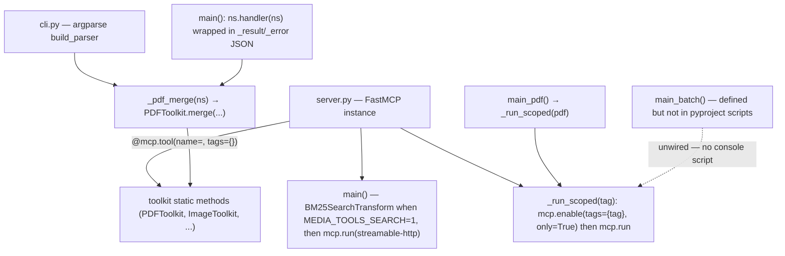

## Two Entry Points, One Set of Toolkits

`media-tools` ships a single set of nine toolkit classes — `PDFToolkit`, `ImageToolkit`,
`AudioToolkit`, `VideoToolkit`, `OfficeToolkit`, `AIToolkit`, `PiiToolkit`, `ProbeToolkit`,
and `TTSToolkit` — and exposes them through **two presentation layers** that delegate to the exact
same toolkit static methods:

- **MCP server** (`src/media_tools/server.py`) — a `FastMCP` instance that registers all **104 tools**
  with `@mcp.tool` decorators carrying a family tag. The full server exposes everything; seven
  category-scoped console scripts expose only the tools tagged with one family.
- **CLI** (`src/media_tools/cli.py`) — a hand-rolled `argparse` dispatcher with a two-level
  `category → command` structure and **87 commands** across `pdf`, `image`, `audio`, `video`,
  `office`, `pii`, `batch`, `returns`, and `probe`.

The two files are **not duplicate logic.** `server.py` imports toolkit classes from
`media_tools.tools` and wraps each method in a `@mcp.tool(name=..., tags={...})` decorator; `cli.py`
imports toolkit classes from individual submodules and calls the same methods from its command
handlers. Both are thin shells — the toolkits themselves hold no shared mutable state and behave
identically regardless of which entry point invokes them.

```
Client → entry point (FastMCP handler or CLI handler) → ToolkitClass.method()
```

## Console Scripts in pyproject.toml

`[project.scripts]` defines exactly **nine** console entry points, each mapping a command name to a
single Python callable:

```toml
[project.scripts]
media-tools = "media_tools.cli:main"
media-tools-server = "media_tools.server:main"
media-tools-server-pdf = "media_tools.server:main_pdf"
media-tools-server-image = "media_tools.server:main_image"
media-tools-server-audio = "media_tools.server:main_audio"
media-tools-server-video = "media_tools.server:main_video"
media-tools-server-office = "media_tools.server:main_office"
media-tools-server-ai = "media_tools.server:main_ai"
media-tools-server-tts = "media_tools.server:main_tts"
```

The first is the CLI dispatcher (`media-tools → cli.main`). The second is the full MCP server
(`media-tools-server → server.main`). The remaining **seven** are category-scoped servers; each maps
to a `server.main_*` function (`main_pdf` … `main_tts`), which in turn calls the shared
`_run_scoped(tag)` helper. Installing the package makes all nine commands available on `PATH` with a
single definition — no per-category server code.

There is no `media-tools-server-batch` script: `server.py` defines an eighth function, `main_batch()`
(tag `batch`), but `pyproject.toml` does not wire it, so `batch_sweep` is reachable only through the
full server or through the CLI's `batch sweep` command. Likewise there is no scoped script for `pii`
or `probe`, so those tools are also full-server-only on the MCP side.

## Server Registration and Scoped Enable

`server.py` builds a single `FastMCP` instance named "Media Tools" and registers each tool with a
`@mcp.tool` decorator that carries a `tags={...}` family value. Every decorator is a thin wrapper
that delegates to the corresponding `ToolkitClass.method()`:

```python
mcp = FastMCP("Media Tools", instructions="...")

@mcp.tool(name="pdf_merge", tags={"pdf"})
def pdf_merge(files: list[str], output: str, cover: bool = False) -> str:
    """Merge multiple PDF files into a single output file. cover=True also renders a page-1 thumbnail."""
    return PDFToolkit.merge(files, output, cover)
```

At module load, `server.py` calls `setup_logging(os.environ.get("LOG_LEVEL", "INFO"))` so the
`media_tools` logger is configured before any request is handled. Six toolkit classes are imported
at module level (`AudioToolkit`, `ImageToolkit`, `OfficeToolkit`, `PDFToolkit`, `PiiToolkit`,
`VideoToolkit`); `AIToolkit`, `TTSToolkit`, and `ProbeToolkit` are imported *inside* their tool
functions, which keeps module load light and keeps the heavy toolkits off the import path of every
other tool.

### MEDIA_TOOLS_SEARCH mode

When the `MEDIA_TOOLS_SEARCH=1` environment variable is set, `main()` adds a
`BM25SearchTransform(max_results=5)` before starting the server. This replaces the default
`tools/list` exposure (the source comment notes 85 tools ≈ 13.7 k tokens) with a two-endpoint search
interface — `search_tools` and `call_tool` (≈330 tokens) — that uses lexical BM25 ranking to find
the most relevant tools for a query. This is useful for clients with tight context windows. The
ceiling is that BM25 is purely lexical, so vague or semantically distant queries may miss; a
vector-based transform is the documented upgrade path if this becomes a problem. The transform is
installed only by `main()` — the scoped entry points never add it.

```python
def main():
    if os.environ.get("MEDIA_TOOLS_SEARCH") == "1":
        from fastmcp.server.transforms.search import BM25SearchTransform
        mcp.add_transform(BM25SearchTransform(max_results=5))
    port = int(os.environ.get("PORT", "8020"))
    host = os.environ.get("HOST", "127.0.0.1")
    mcp.run(transport="streamable-http", host=host, port=port)
```

The full server (`main`) runs over the `streamable-http` transport on a configurable `PORT`
(default 8020) and `HOST` (default `127.0.0.1`). `stdio` is intentionally not used because it
only works for local CLI agents, whereas `streamable-http` supports browser clients such as
OpenWebUI.

Category-scoped servers are enabled by the shared `_run_scoped(tag)` helper, which calls
`mcp.enable(tags={tag}, only=True)` to expose **only** the tools tagged with that family before
starting the server. This lets an operator run a lean server (e.g. `media-tools-server-ai`) instead
of all 104 tools, without maintaining separate server code:

```python
def _run_scoped(tag: str):
    mcp.enable(tags={tag}, only=True)
    port = int(os.environ.get("PORT", "8020"))
    host = os.environ.get("HOST", "127.0.0.1")
    mcp.run(transport="streamable-http", host=host, port=port)


def main_pdf():
    _run_scoped("pdf")
```

## CLI Subcommand → Handler Dispatch

The CLI uses a hand-rolled `argparse` parser with a two-level structure: `category → command`.
Handlers are plain functions taking a parsed namespace (`ns`), and the `add()` helper registers each
command with its flags and stores the handler via `set_defaults(handler=handler)`:

```python
def add(cat_parsers, name, handler, *arg_specs):
    sub = cat_parsers.add_parser(name)
    for flags, kwargs in arg_specs:
        sub.add_argument(*flags, **kwargs)
    sub.set_defaults(handler=handler)
```

`main()` parses arguments, dispatches to the selected handler (`ns.handler(ns)`), and wraps the
outcome in JSON via `_result()` / `_error()` helpers so agents can parse results uniformly:

```python
def main(argv: list[str] | None = None) -> int:
    parser = build_parser()
    ns = parser.parse_args(argv)
    try:
        result = ns.handler(ns)
    except Exception as exc:
        print(_error(str(exc)))
        return 1
    print(_result(result))
    return 0
```

Handlers pull their arguments from the parsed namespace and call the same toolkit methods the MCP
wrappers call, guaranteeing behavioral consistency across interfaces. For example:

```python
def _pdf_merge(ns):
    return PDFToolkit.merge(ns.input, ns.output, ns.cover)
```

Eighty-six commands are registered through `add(...)` calls inside `build_parser()`; the `probe`
category is the one exception — it attaches its single handler directly with
`probe_cat.set_defaults(handler=_probe)` and takes only a positional `input`, because it is a
read-only router rather than a transforming command.

AI and TTS toolkits are **MCP-only** — they have no CLI commands, so no `ai` or `tts` category
appears in the CLI parser.

## How the Two Layers Map

The table below shows how each presentation layer maps to the shared toolkits. The `enable(tags)`
mechanism in the server and the `category → command` structure in the CLI partition the same tools
by family, but both resolve to the identical toolkit static methods.

| Toolkit / Category | MCP tools (server.py) | CLI commands (cli.py) |
|---|---|---|
| `PDFToolkit` | 31 tools tagged `pdf` | 24 commands under `pdf` |
| `ImageToolkit` | 24 tools tagged `image` | 22 commands under `image` |
| `AudioToolkit` | 13 tools tagged `audio` | 12 commands under `audio` |
| `VideoToolkit` | 24 tools tagged `video` | 22 commands under `video` |
| `OfficeToolkit` | 5 tools tagged `office` | 2 commands under `office` |
| `PiiToolkit` | 2 tools tagged `pii` | 2 commands under `pii` |
| `AIToolkit` | 3 tools tagged `ai` | — (MCP only) |
| `TTSToolkit` | 1 tool tagged `tts` | — (MCP only) |
| Batch (sweep) | 1 tool tagged `batch` | 1 command under `batch` |
| Returns (stash) | 1 tool tagged `pdf`* | 1 command under `returns` |
| Probe (cross-cutting) | 1 tool tagged `pdf`* | 1 command under `probe` |
| **Total** | **104 tools** | **87 commands** |

\* `media_probe` and `returns_reclaim` are cross-cutting utilities routed through the `pdf` tag so
they are included in `media-tools-server-pdf` scoped deployments.

Two MCP wrappers are also tagged by the media they consume rather than the toolkit that implements
them: `image_to_video` (tagged `image`) and `audio_to_video` (tagged `audio`) both delegate to
`VideoToolkit`. `video_extract_frames` (tagged `video`) likewise has no CLI counterpart — the CLI's
`video info` command maps to `VideoToolkit.probe`, while the MCP `video_probe` tool does the same
job under the `video` tag.

## Server Registration → Scoped Enable and CLI Dispatch

The diagram below traces how a tool is registered once, then either exposed to all clients (full
server), restricted to one family (scoped server via `mcp.enable(tags)`), or invoked from the CLI
(argparse dispatch). All three paths converge on the same toolkit static method.



*Figure: one registration path into the FastMCP instance; `main()` and the seven wired `main_*`
entry points choose what to expose, while argparse dispatch routes CLI commands to the same toolkit
methods.*

The server instance registers every tool once via its `@mcp.tool` decorator; the full `main()` and
each category-scoped `main_*` (through `_run_scoped`) control *which* tools are exposed, while the
CLI parser maps each `category → command` to the identical toolkit method.

## See Also

- [Architecture Overview](overview.md) — end-to-end request flow and the shared `utils.py`
  validation/logging pipeline.
- [Quickstart](../quickstart.md) — installing the package and running the server or CLI.
- [Deployment](../operations/deployment.md) — how the console scripts and `PORT`/`HOST` are used in
  practice.
