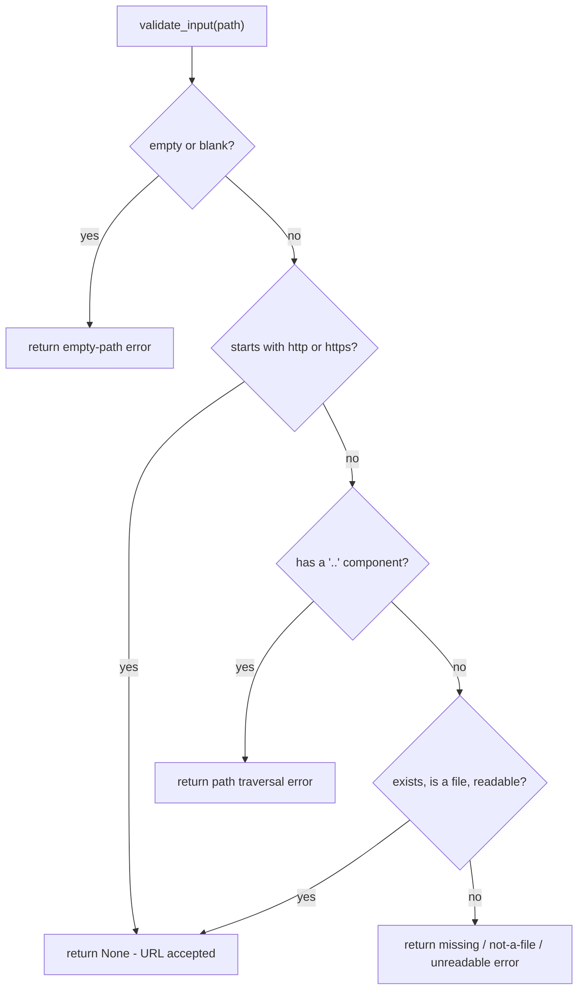

The media-tools package centralizes input validation, output-directory handling, and failure reporting in `src/media_tools/utils.py`, with a second layer of structured refusal tickets in `src/media_tools/refusals.py`. Every front door sits on that contract: the FastMCP server (`src/media_tools/server.py`, 104 registered `@mcp.tool` wrappers), the agent-native CLI (`src/media_tools/cli.py`), and the batch sweeper (`src/media_tools/sweep.py`) all call toolkit static methods that return plain strings.

The contract has two halves:

1. **A gate.** A method that reads a file calls `validate_input` first and, when it produces an artifact, `validate_output_dir` next — before it writes, shells out, or calls a model.
2. **A failure representation.** Methods return strings instead of raising. Callers recognize failure by the literal `Error: ` prefix or by a truthy validation message, and a small set of high-value refusals additionally carries a structured ticket that renders byte-identically to the historical message.

## The validation contract

Each public toolkit method begins with the same shape:

```python
err = validate_input(input_path)
if err:
    return err
...
err = validate_output_dir(output)
if err:
    return err
```

The ordering is the point: inputs are validated before the output location, and both run before the work phase. Methods return early on the first error, so a bad input never reaches a write, a subprocess spawn, or a model call. The gate is not entirely side-effect free — `validate_output_dir` may create the directory it is about to check — but no *work* happens before validation passes.

### `validate_input`

`validate_input(path, label="input")` returns an error string if the path is invalid, otherwise `None`. It performs four checks in sequence:

1. **Empty check** — a blank or whitespace-only path returns `"{label} path is empty"`.
2. **URL passthrough** — any path starting with `http://` or `https://` is accepted immediately (`return None`), before any filesystem check runs.
3. **Path-traversal blocking** — the path is split with `pathlib.Path(path).parts`, and if any component equals `'..'` the call returns `"{label} path contains '..' — path traversal blocked: {path}"`.
4. **Existence / file / readability** — the path must `exists()`, `is_file()`, and pass `os.access(path, os.R_OK)`, yielding `"does not exist"`, `"is not a file"`, or `"is not readable"` messages.

Because the `'..'` check runs before the `exists()` check, `../../etc/passwd` is reported as a traversal attempt rather than "does not exist" — a deliberate ordering that surfaces the security intent in the error text instead of leaking filesystem state.



Figure: the `validate_input` decision order — URL and `..` checks run before `exists()`.

### `validate_output_dir`

`validate_output_dir(path, label="output")` returns an error string if the output location cannot be written, otherwise `None`. It derives the target directory (`p.parent` if the path has a suffix, else the path itself), creates it with `Path.mkdir(parents=True, exist_ok=True)` when absent (catching `OSError` and returning `"cannot create output directory ..."`), and finally checks `os.access(str(parent), os.W_OK)`, returning `"output directory is not writable"` when it fails. The auto-create step is what lets callers pass a not-yet-existing nested directory without pre-creating it.

`safe_basename(path)` is the related helper that returns `Path(path).name`, stripping parent components wherever only a filename is wanted.

### How toolkits apply the gate

- **Multi-input methods validate every input first.** `PDFToolkit.merge` loops `validate_input` over all files before it touches `output`; `ImageToolkit.merge`, `VideoToolkit.merge`, and `OfficeToolkit.edit` (which writes `validate_input(input_path) or validate_output_dir(output)` in one expression, short-circuiting input-first) do the same.
- **Output validation is conditional where output is optional.** `PDFToolkit.extract_text`, `OfficeToolkit.to_markdown`, and `AIToolkit.summarize` / `qa` call `validate_output_dir` only when an `output` argument was supplied; read-only methods (`PDFToolkit.info`, `PDFToolkit.compare`, `ProbeToolkit.probe`, `PiiToolkit.scan`) never call it.
- **Domain guards run after the gate but before mutation.** Page-range checks in `reorder_pages` / `delete_pages`, the in-place refusal in `OfficeToolkit.edit`, and format/argument checks in the image toolkit all sit behind validation and ahead of the write.

## The `'Error: ...'` return-string convention

Rather than raising, toolkit methods return strings. Successes are human-readable status lines (e.g. `"Merged N files into ..."`); failures come in three flavors:

- **Validation failures** return the exact message from `validate_input` / `validate_output_dir`. These do **not** carry the `"Error: "` prefix (e.g. `"{label} path is empty"`), so a caller that tests `startswith("Error")` will miss them — only truthiness (`if err:`) catches every failure. The assertion scripts rely on this split: `tests/check_html_to_pdf.py` checks `"does not exist" in ...` for a validation miss and `.startswith("Error")` for a domain miss.
- **Runtime failures** are wrapped in `f"Error: {exc}"` inside `except` blocks — the dominant pattern across all toolkits.
- **Domain guards** return literal `"Error: ..."` strings for preconditions validation cannot see: `"Error: page {p} out of range (1-{total})"` in `reorder_pages` / `delete_pages`, `"Error: PDF is not password-protected"` in `unlock`, `"Error: specify either text or image_path"` in `watermark`, `"Error: input must be a local HTML file, not a URL"` in `html_to_pdf`.

**Who reads the prefix.** In-process callers do: `sweep` classifies a per-file result with `result.lower().startswith("error")` and records it in the manifest; `OfficeToolkit.edit` unwinds a partial copy when `_run_cli` returns `"Error..."`; `AIToolkit` propagates a failed document read before calling the model; the assertion scripts assert on it throughout.

**What the front doors do with it.** The CLI's `_result` helper passes a value through as JSON when it already parses, and otherwise wraps it as `{"result": value}`; `_error` builds `{"error": msg}` but is used *only* when an exception escapes a handler — `main` catches `Exception`, prints `_error(str(exc))`, and exits 1. So a toolkit-returned `"Error: ..."` string reaches stdout inside a `{"result": ...}` envelope, not `{"error": ...}`; detecting CLI failures means inspecting the string, not the key. The MCP wrappers return the string verbatim as the tool result, and `sweep` converts only its own top-level failures into `{"error": msg}`.

## The refusal-ticket layer

`src/media_tools/refusals.py` adds structure without changing any of the above. `TicketedString` is a `str` subclass whose text is byte-identical to the historical `Error: ...` message; the structured data rides along as `.ticket` (a frozen `Ticket` dataclass: `code`, `reason`, `fix_hint`, `docs_link`, `remedy`) and `.to_dict()`. No caller is required to read the ticket — string comparisons, prefix checks, and JSON serialization all behave exactly as before, and the ticket is invisible once the value has been serialized (agents that want it must read `.to_dict()` first).

`REGISTRY` holds the static metadata for the three stable codes:

| Code | Meaning | `remedy` | `fix_hint` (summary) |
| --- | --- | --- | --- |
| `E_OVERWRITE_BLOCKED` | refused to write over the input | `use_different_output` | pass a different output path; edits are never in place |
| `E_ENCRYPTED_PDF` | encrypted PDF refused | `unlock_first` | unlock with `pdf_unlock` or supply the password |
| `E_MISSING_BINARY` | external binary absent | `install_binary:<name>` | brew/apt install commands |

`reason` is per-instance (it is the message itself); `docs_link` is currently empty for all three codes. The wiring points today are exactly three: `OfficeToolkit.edit` returns `overwrite_blocked(...)` when output resolves to input, `PDFToolkit.pdf_to_markdown` returns `encrypted_pdf(...)` on `anydoc.EncryptedError`, and `PDFToolkit.pdf_to_a` returns `missing_binary(..., binary="gs")` when Ghostscript raises `FileNotFoundError`. `tests/check_refusals.py` is the executable spec: it asserts each refusal string is unchanged, that `.ticket.code` / `.ticket.reason` / `.ticket.fix_hint` / `.ticket.remedy` are populated, that `set(REGISTRY)` equals the three codes, and that `json.dumps(res.to_dict())` works.

## The subprocess-with-logging helper

`_subprocess_with_logging(cmd, description)` in `utils.py` runs an external command and returns a `(result_string, success)` tuple — `(description, True)` on success, or `("Error: <stderr>", False)` when the return code is non-zero. It logs the command at debug level and the outcome at info/error level, so a failed binary's stderr lands verbatim in the returned string.

Callers that shell out to a required binary use it: `OfficeToolkit.to_pdf` (`soffice --headless --convert-to pdf`), `PDFToolkit.pdf_to_a` (`gs`), `PDFToolkit.html_to_pdf` and `_to_docx_soffice` (LibreOffice), and the `VideoToolkit` ffmpeg operations (convert, trim, compress, gif, extract-audio, crop, rotate, resize, reverse, mute, speed, merge, thumbnails, contact sheet, watermark, subtitle burn, slideshow, social pack, chroma cut, object erase, blur faces).

### Inconsistent subprocess handling

Not every external command goes through the helper:

- **OfficeCLI and Firecrawl** run through `_run_cli` in `office.py`, a raw `subprocess.run(cmd, capture_output=True, text=True, timeout=120)`. It hand-rolls its own error strings: `FileNotFoundError` → `"Error: {cmd[0]} not found..."` (with an install hint only for `officecli`), `TimeoutExpired` → `"Error: officecli timed out"` (message is hardcoded even for the Firecrawl invocation), non-zero return code → `f"Error: {(r.stderr or r.stdout).strip()}"`. This is the path behind `OfficeToolkit.inspect` (`officecli view ...`) and `OfficeToolkit.url_to_markdown` (`firecrawl scrape <url> ...`).
- **`VideoToolkit.probe`** runs `ffprobe` with a raw `subprocess.run` and returns `f"Error: {result.stderr}"` on a non-zero return code, logging the same text at error level.
- **Probe helpers degrade instead of failing.** `probe.py`'s `_ffprobe_streams` guards with `shutil.which("ffprobe")` and returns `None` on a missing binary, non-zero exit, or unparsable JSON; `video.py`'s `_probe_duration` and `_stream_codecs` likewise return `None` so callers fall back rather than report an error.

The `(result_string, success)` contract is therefore not applied uniformly — some paths rely on ad-hoc return-code checks, and one returns `None` rather than a string. Relatedly, `_subprocess_with_logging` does **not** catch `FileNotFoundError`: a missing `soffice`, `gs`, or `ffmpeg` escapes the toolkit method as an exception (only `pdf_to_a` converts it, into a ticketed `missing_binary` refusal), and is turned into an error string only at the CLI boundary, where `main` catches it.

## URL passthrough

`validate_input`'s URL short-circuit exists so URL-shaped arguments are never tripped by the filesystem checks below it. Its consumers are narrower than the check itself:

- `PDFToolkit.html_to_pdf` explicitly rejects URLs (`"Error: input must be a local HTML file, not a URL"`) *before* calling `validate_input` — local HTML only, by design, and `tests/check_html_to_pdf.py` asserts both directions.
- `OfficeToolkit.url_to_markdown` never calls `validate_input` at all: it enforces `http://` / `https://` itself and rejects anything else (including `file:///...`), then hands the URL to the Firecrawl CLI.
- `PDFToolkit.pdf_to_markdown` and `AIToolkit` (summarize / qa / translate) run the normal `validate_input` gate and read the document locally through `anydoc`; their LiteLLM calls target a configured endpoint (`LITELLM_URL`, default `http://localhost:4000`), not tool input.

So the traversal defense and the URL bypass are both decided in `utils.py`, but the tools that actually fetch remote content do their own scheme checks on top of it.

## Coverage and exceptions

The gate is close to universal now: `pdf`, `image`, `audio`, `video`, `office`, `ai`, `pii`, and `probe` all import and call `validate_input`, and all but the read-only methods call `validate_output_dir`. The exceptions that remain:

- `TTSToolkit.convert` takes text, not a file, so it calls `validate_output_dir` only (and guards `text.strip()` itself).
- Read-only methods skip `validate_output_dir`; optional-output methods call it only when `output` is truthy.
- `sweep()` validates directories with its own checks (required output dir, `'..'` traversal, `is_dir`, readability) before delegating to `validate_output_dir`, and refuses an output directory that equals or lives inside the input directory — sweep never writes in place.
- Output overwrites are blocked where they matter most: `returns_reclaim` refuses to restore over an existing file unless an explicit `output` path is given, and `OfficeToolkit.edit` refuses in-place edits with the ticketed `E_OVERWRITE_BLOCKED`.

## Representative tests

- `tests/check_redact.py` exercises the happy path end to end: it builds a two-page PDF, calls `PDFToolkit.redact(src, out, text_patterns=["TOPSECRET"])`, asserts the result starts with `"Redacted"`, that the secret is gone from the output bytes, and that the untouched second page survives — a method that runs `validate_input` / `validate_output_dir`, stashes the original via `stash_return`, and then rasterizes.
- `tests/check_refusals.py` is the ticket specification: string-identical output, inspectable `.ticket`, the exact `REGISTRY` key set, and a JSON-serializable `to_dict()`.

See also [Architecture Overview](../architecture/overview.md) for the three front doors, [PDF tools](../tools/pdf.md) for the largest consumer of the gate, and [Document pipelines](../workflows/document-pipelines.md) for how these strings chain across tools.
